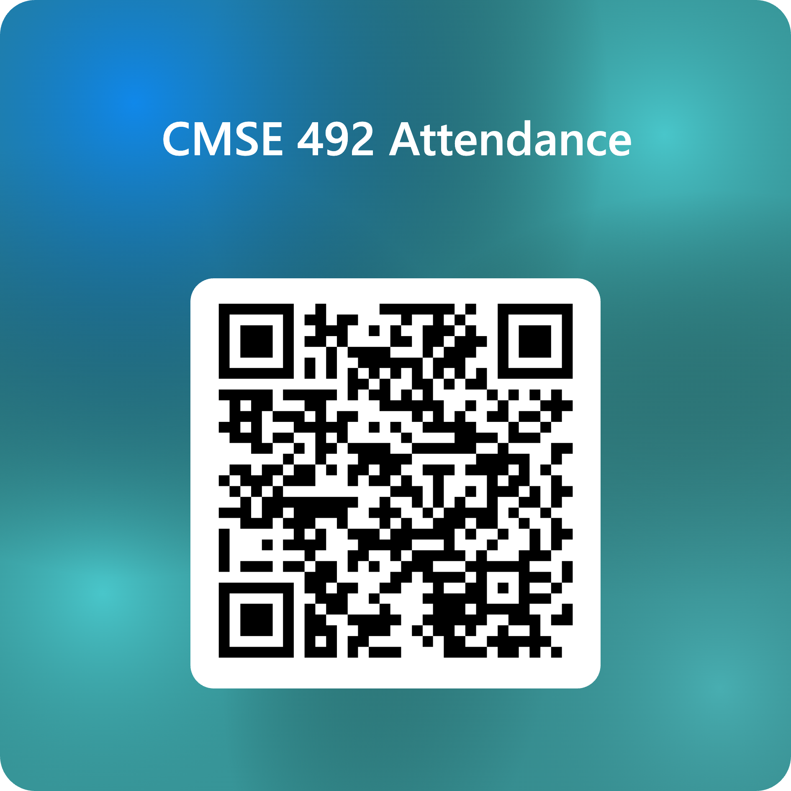
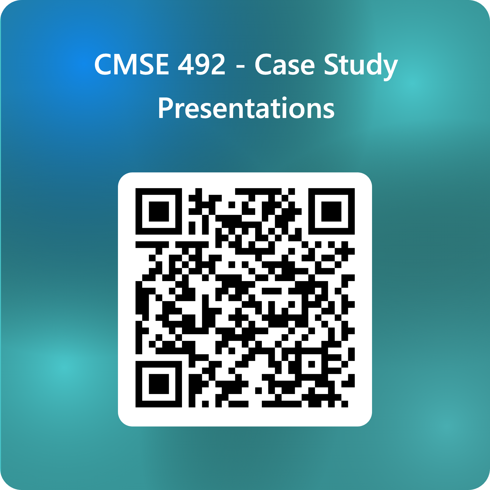

<!-- _class: title -->
# AI in the Real World
## Data, Power, & Society - Day 25

### Full Case III Work Day

**CMSE 492 (aka CMSE 101) • Fall 2026**
Prof. Danny Caballero

  
## Today's Six Digits: 438917

---

# Today: Work on Part A

1. **Settle on your case** if you haven't yet: named tool, named organization, documented deployment
2. **Find your sources** and keep working through **Part A**, starting with **Section 0 (Your Notes/Research)**
3. **Check Full Case II feedback** on D2L. If you need to revise, **your one-week clock started when it was posted.**

**The Full Case III Update is due Sun, Nov 1.**

*We'll be circulating. Ask us anything.*

---

<!-- _class: title -->
# Presenting a Case Study

---

# Last Call: Present a Case Study

Starting the **week of Nov 9**, your group can present **one case study of your choice**:

- **20 minutes** presenting, then **5 minutes** of questions
- **Write the Exit Ticket** for that day
- **Submit your slides** to be posted on D2L *before* your day

**Opt-in, as a whole group.** Everyone in the group must agree and take part. It counts toward **Class Engagement** (*2 -> 4 for both Case Study grades, 100% bonus*).

---

# Interested? Fill Out the Survey

- **Only one person per group** fills it out
- **Be generous** with the days you can do. We're coordinating across groups.
- **Due Mon, Nov 2**, which is the next class day. **Talk to your group before you leave today.**
- **Email from Danny** with the schedule. It will also be posted on D2L.

[https://forms.cloud.microsoft/r/Nx6YYX7F6r](https://forms.cloud.microsoft/r/Nx6YYX7F6r)
*This link is also on D2L.*

---

# No Exit Ticket Today

- Exit Tickets are **only after Wednesday's class**.
- **No Exit Ticket today.**

---

# Forum Posts and Metacognitive Reports

**Starting Nov 9th, these posts and reports will become reflective over the whole semester.**

> Each week will ask you to reply to different parts of the DTPA framework and AI Literacies. 
> We will ask you to review your prior work and reports to do so; providing evidence from that work.

- **Week 11** - Data (Forum Post) and Data Literacy (Metacognitive Report) 
- **Week 12** - Tools (Forum Post) and Quantitative Literacy (Metacognitive Report)
- **Week 13** - Practices (Forum Post) and Ethical Literacy (Metacognitive Report)
- **Week 14** - Actions (Forum Post) and Critical Literacy (Metacognitive Report)

---

# Reminders

- **Sun, Nov 1:** Full Case III Update (Part A) due
- **Sun, Nov 1:** Week 9 Individual Effort & Metacognitive Report due
- **Sun, Nov 1:** Week 10 Forum Post due
- **Mon, Nov 2:** Presentation survey due (one per group)
- **Fri, Nov 6:** Case Design Scaffold 2 due (with revised Part 1 and response to feedback)

## 🏈 MSU is on a bye this Saturday   Next up: Sat, Nov 7 at Michigan
## 19:30 Saturday on ESPN   Mississippi State at \#11 Texas 🏈
