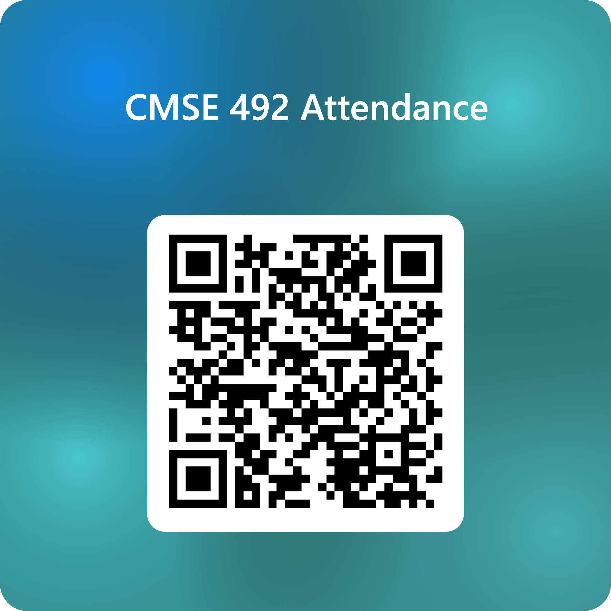

<!-- _class: title -->
# AI in the Real World
## Data, Power, & Society - Day 28

### The Final Project & Updated Presentation Schedule

**CMSE 492 (aka CMSE 101) • Fall 2026**
Prof. Danny Caballero

  
## Today's Six Digits: 902714

---

# Today

1. **Scaffold 2 is due today** (Fri, Nov 6). Submit it on D2L.
2. **The Final Project** is now fully described. We'll walk through it.
3. **Presentation schedule** has been updated. Check your group's day.
4. **Work time** with your Case Design team.

**The Full Case III is due Sun, Nov 8.**

*We'll be circulating. Ask us anything.*

---

<!-- _class: title -->
# The Final Project

---

# Where You Are in the Case Design

You have built your case one scaffold at a time.

- **Scaffold 1** scoped the problem
- **Scaffold 2** built the evidence base and committed to a design direction
- **Final project:** your team **makes the case** for that design, in writing and in front of the class, and each of you looks back at what you learned

Full instructions: **[Final Case Design Project](/assignments/final-project/)** on the course site.

---

# Three Parts

| Part | Who | What | Length |
|---|---|---|---|
| **A. Essay** | Team | An argumentative essay presenting and defending your design | 3000 words minimum |
| **B. Showcase Presentation** | Team (everyone speaks) | A sharp, engaging talk about your case | 12 min + 3 min questions |
| **C. Cover Letter** | Each student | What you learned, how you grew, and the course grade you have earned | About 500 words |

---

# Part A: The Essay Is an Argument

Convince a **skeptical, well-informed reader** who has not seen your scaffolds.

- **State a clear thesis.** One sentence: what you propose and why.
- **Present the design precisely.** Specific enough that someone could build it (or enforce it), and someone who disagrees could argue against it.
- **Foreground the DTPA components that carry your argument.** Name the crux, argue for why, and go deep. Treat the rest more briefly.
- **Show the AI literacies at work.** Don't just name them.
- **Take the strongest objection seriously**, not the easiest one.
- **Close critically pragmatic.** Technology is neither the savior nor only a harm.

---

# Part A: Naming vs. Showing a Literacy

### Naming (avoid)

*Our project uses quantitative literacy because we looked at accuracy numbers.*

### Showing (aim for)

*The vendor reports 94% accuracy, but only 3% of cases in the validation set were positive. A model that flagged no one would score 97%. The number that matters is the false-negative rate, which the vendor does not publish. Our proposal requires it.*

---

# Part A: Evidence and Format

- Build from your **Scaffold 2 annotated bibliography**: at least **8 sources**, at least **3 different kinds**
- Every claim traceable to your reference list, in **APA**
- Every number says **where it came from** and **what it was measured on**
- **3000 words minimum**, connected prose, one consistent voice
- Title, team names, and pathway at the top
- **Disclose any AI use**: which tool, and for what

You may **not** turn in the final essay until **after** your group presents.

---

# Part B: The Showcase

**12 minutes presenting + 3 minutes of questions.** Everyone on the team speaks.

Not your essay read aloud. **One argument, made clearly.**

| Section | Time |
|---|---|
| Hook: a person, a number, or an incident | ~1.5 min |
| The problem or system | ~1.5 min |
| The crux (DTPA + literacy) | ~3 min |
| **The proposal** | ~3.5 min |
| Risks and trade-offs | ~1.5 min |
| Closing: the one thing to remember | ~1 min |

8 to 12 slides is usually enough. **Put a source on every slide with a number or claim.**

---

# Part B: Feedback You Will Receive

After each talk, the audience answers three questions:

1. What was the **most convincing** part of this proposal?
2. What is the **biggest weakness** or unanswered question?
3. If you were implementing (or affected by) this proposal, what would you **want to know**?

Your team gets this feedback after the Showcase and uses it for **"Changes after the Showcase"** in the final essay.

The Showcase is not graded on its own, but **completing it is required for a Case Design grade of 3.0 or higher.**

---

# Part C: The Cover Letter

An **individual** letter to Danny, about **500 words**, first person. The last (and most important) Effort & Metacognitive Report.

| Section | Words |
|---|---|
| What you learned from your case design | ~125 |
| How you have grown in DTPA and AI literacies (**compare earlier work to later work**) | ~150 |
| **The course grade you have earned, and why** | ~225 |

For the grade: claim a level for **Class Engagement (40%)**, **Case Studies (30%)**, and **Case Design (30%)**, with evidence. Include **your own contribution to the team**.

---

# Final Project Timeline

| Date | What |
|---|---|
| **Fri, Dec 4** | Essay draft + response to Scaffold 2 feedback (>250 words) |
| **Mon, Dec 7** | Showcase Day 1 (3 groups). Slides before class. |
| **Wed, Dec 9** | Showcase Day 2 (3 groups). Slides before class. |
| **Fri, Dec 11** | Showcase Day 3 (2 groups). Slides before class. |
| **Tue, Dec 15, 11:59pm** | Final essay with "Changes after the Showcase" (team) and cover letter (individual) |

Your Showcase day will be posted on D2L. **No in-class final exam.**

---

<!-- _class: title -->
# Presentation Schedule

---

# Updated Presentation Schedule

**Groups 05 and 08 are new.** Thank you to every group that stepped up.

| Date | Day | Presenting Group |
|:----:|:---:|------------------|
| Nov 9 | Mon | *No presenter: Case Design work time* |
| **Nov 11** | Wed | **Group 07** (Education) |
| **Nov 16** | Mon | **Group 03** (Education) |
| **Nov 18** | Wed | **Group 05** (Retail & Consumer) |
| **Nov 23** | Mon | **Group 01** (Athletics & Sports) |
| Nov 25 | Wed | *No presenter: Case Design work time* |
| **Nov 30** | Mon | **Group 08** (Athletics & Sport) |
| **Dec 2** | Wed | **Group 06** (Healthcare) |

*Also posted on D2L and in the [course schedule](/schedule/).*

---

# If You Are Presenting

- **20 minutes** presenting, then **5 minutes** of questions, in the last 25 minutes of class
- **Send your session plan to Danny 3 days before** your day
- **Write the Exit Ticket** for your day
- **Submit your slides** to be posted on D2L *before* your day
- **Individual reflection** (~150 words) is due that Sunday at 11:59pm, *instead of* your case analysis that week

**Group 07 presents Wednesday.** Your session plan is due to Danny on **Monday** (Nov 9).

---

# Work Time

Use the rest of class with your Case Design team.

- **Submit Scaffold 2** if you haven't yet
- **Finish Full Case III**: it is due Sunday
- **Read the Final Project page** together and decide how to split the essay and the talk
- **Start naming the "crux of the biscuit" (RIP Frank Zappa):** which DTPA component(s) does your design highlight?

*We'll be circulating. Ask us anything.*

---

# No Exit Ticket Today

- Exit Tickets are **only after Wednesday's class**.
- **No Exit Ticket today.**

---

# Deadlines

- **Fri, Nov 6:** Case Design Scaffold 2 due (1500 words, plus response to Scaffold 1 feedback, >250 words)
- **Sun, Nov 8:** Full Case III (complete) due
- **Sun, Nov 8:** Week 10 Individual Effort & Metacognitive Report due
- **Sun, Nov 8:** Week 11 Forum Post due (**Data**, reflecting on your semester's work)
- **Wed, Nov 11:** Group 07 presents
- **Fri, Dec 4:** Essay draft + response to Scaffold 2 feedback due
