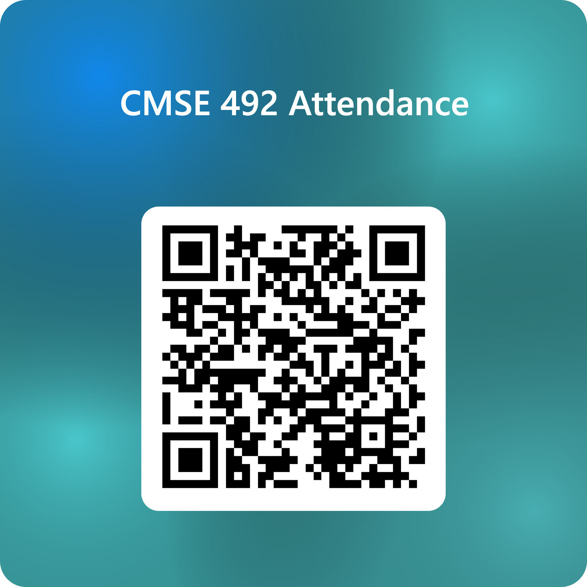

<!-- _class: title -->
# AI in the Real World
## Data, Power, & Society - Day 33

### Group 05 Presents

**CMSE 492 (aka CMSE 101) • Fall 2026**
Prof. Danny Caballero

  
## Today's Six Digits: 745283

---

# Today

1. **A few small reminders**
2. **Group 05 presents**
3. **Work time** with your Case Design team

---

# Reminders

- **Pay attention and ask questions** during today's presentation.
- **Wednesday's Exit Ticket** will include the questions from **both** presenting groups 
  - Group 03 on Monday & Group 05 today
- **Group 01** presents on Monday. See the slide after the presentation.

---

<!-- _class: title -->
# Group 05 Presents

---

# Group 05 (Retail & Consumer)

## At 13:05

- Give them your full attention.
- **Ask questions.** It's the best part.
- **Group 05's exit ticket questions** will be part of **Wednesday's Exit Ticket**, along with Group 03's.

---

# Up Next: Group 01 (Athletics & Sports)

You present on **Monday, Nov 23**. Please get to Danny:

- **Your session plan**
- **Your slides**
- **Your exit ticket** for the class

*Everyone in the group takes part.*

---

# Work Time

After the presentation, work with your Case Design team:

- **Thesis:** one sentence. Can everyone on the team say it?
- **Crux:** which DTPA component(s) does your design turn on?
- **Split the work** for the crux and proposal sections.

*We'll be circulating.*

---

# Deadlines

- **Today:** Exit Ticket (Groups 03 & 05) on D2L
- **Today:** Full Case III revisions due (*Not yet* groups only)
- **Thu, Nov 19:** Week 12 Forum Replies (optional)
- **Sun, Nov 22:** Individual reflection due
- **Fri, Dec 4:** Essay draft + response to Scaffold 2 feedback (>250 words) due
