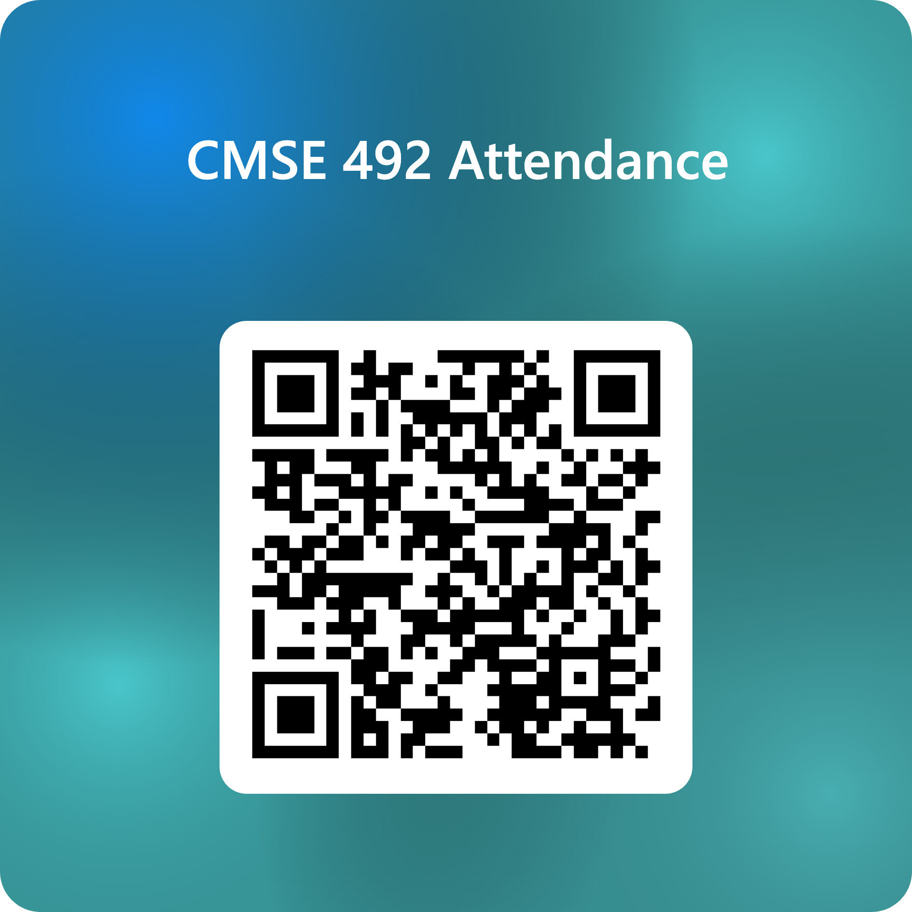

<!-- _class: title -->
# AI in the Real World
## Data, Power, & Society - Day 34

### Case Design Work Day

**CMSE 492 (aka CMSE 101) • Fall 2026**
Prof. Danny Caballero

  
## Today's Six Digits: 293906

---

# Today

Full-period **work time** on your Case Design.

1. **The next two weeks** (schedule change!)
2. **What's left:** the final deliverables
3. **The Showcase:** raising the bar
4. **Work time** with your team

---

# The Next Two Weeks

| Day | Date | What |
|:---:|:----:|------|
| M | **Nov 23** | **Group 01** (Athletics & Sports) presents + **Exit Ticket** |
| W | ~~Nov 25~~ | **No class.** Happy Thanksgiving! |
| F | ~~Nov 27~~ | **No class.** University closed |
| M | **Nov 30** | **Group 08** (Athletics & Sport) presents |
| W | **Dec 2** | **Group 06** (Healthcare) presents |
| F | **Dec 4** | Last work session · **Essay draft due** |

**Monday is our last class before the break.** Come ready for Group 01 and the exit ticket.

---

# What's Left: The Final Project

| Part | Who | What |
|---|---|---|
| **A. Essay** | Team | An argument for your design, **3000 words minimum** |
| **B. Showcase** | Team (everyone speaks) | **12 min** talk + 3 min of questions |
| **C. Cover letter** | Each of you | ~500 words: what you learned, how you grew, the grade you've earned |

Full instructions: **Final Case Design Project** page on the course site.

---

# Final Project Timeline

| Date | What | Submit on D2L |
|---|---|---|
| **Fri, Dec 4** | Essay draft | Draft + response to Scaffold 2 feedback (>250 words) |
| **Dec 7 / 9 / 11** | Showcase | Slides, **before class** on your day |
| **Tue, Dec 15**, 11:59pm | Final | Revised essay + "Changes after the Showcase" (team); cover letter (individual) |

- You **can't** submit your final essay until **after** your group presents.
- The Final Case Design gets **no second attempt**. Use your feedback well.

---

<!-- _class: break -->
# The Showcase: Raising the Bar

---

# Some feedback

The group-led sessions have been useful and informative. But the talks have been **short**, and folks have often **read directly from the slides**.

That's my bad; I should have communicated more clearly what meets a standard for a presentation. 

Short or read presentations **won't** meet the standard for the Showcase.

A Showcase that's too short, or read off the slides, is graded **not meeting expectations**. Your Case Design then **can't go above a 2.0**.

**Think about the best presentations you've seen.** What made them so?

<!--_speaker_note:
Keep this matter-of-fact, not scolding. The group-led sessions were lower stakes on purpose. The Showcase is the capstone and is held to a higher bar. The syllabus and the Final Project page now spell this out.
-->

---

# The Showcase Standard

| Meets the standard | Does not |
|---|---|
| **10–12 minutes** before questions | Under 10 minutes |
| Talking **to the audience**, short notes | Reading slides or a script aloud |
| **Everyone** presents a real part | One or two people carry it |
| **Rehearsed:** smooth handoffs, on time | Working out who's next as you go |
| Case, proposal, crux, **strongest objection** | Describes the topic, argues for nothing |

**Test:** if your slides vanished five minutes before class, could you still give the talk?

---

# Make It a Performance: Pick a Role

### Pathway I: Solution

- **Startup pitch:** the class is your investors or a city council
- **Product launch:** to the teachers, nurses, or caseworkers who will use it
- **Procurement hearing:** your agency vs. a skeptical oversight board

### Pathway II: Restriction

- **Legislative testimony:** the class is the committee voting on your bill
- **Regulator's announcement:** the new rule, and how it's enforced
- **Closing argument:** to a jury, for the people harmed
- **Advocacy campaign:** who's affected and what you demand

*Not required, but strongly encouraged. A role gives you someone to persuade, and it stops you from reading.*

---

# Bring In the Opposition

- **The lobbyist.** One teammate plays the industry lobbyist, vendor, or skeptical official and delivers your **strongest objection**, in character. The team answers.
- **The person affected.** One teammate tells the story of a real person from your sources: your hook, or your close.
- **Stay in character for Q&A.** The committee questions the witnesses; the investors grill the founders.

A role doesn't replace content: you still need the **proposal**, the **crux**, the **evidence**, and the **objection**.

**Have fun with it.** This is a celebration of your learning.

---

# How to Prepare

- **Rehearse out loud, together, with a timer, at least twice.**
- **Fewer words on slides.** If the sentence is on the slide, you'll read it.
- **Know your part cold.** Notes are cues, not a script.
- **Write down the three questions** you most expect, and decide who answers each.
- **Plan the handoffs.** "And to explain how it's enforced, here's Jorge."

---

# Where Should Your Team Be?

Two weeks until the draft is due, with a holiday in the middle. By the end of today:

- **Thesis:** one sentence everyone on the team can say
- **Crux:** the DTPA component(s) your design turns on, and *why*
- **Strongest objection:** not the easiest one
- **A plan:** who writes which section, and by when

*Make the plan before you leave. You won't see each other again until Nov 30.*

---

# Up Next: Group 08 (Athletics & Sport)

You present on **Monday, Nov 30**, right after the break. Please get to Danny:

- **Your session plan**
- **Your slides**
- **Your exit ticket** for the class

*Everyone in the group takes part. Aim to send it before Thanksgiving.*

---

# Deadlines

- **Sun, Nov 22:** Individual reflection due
- **Mon, Nov 23:** Exit Ticket (Group 01) in class
- *No Week 13 forum post (holiday)*
- **Sun, Nov 29:** Week 14 Forum Post due
- **Fri, Dec 4:** Essay draft + response to Scaffold 2 feedback (>250 words) due
- **Tue, Dec 15:** Final essay + cover letters due

---

# Work Time

Use the rest of the period with your Case Design team.

- Draft the **thesis**, the **crux**, and the **proposal** first. They are the heart of the essay.
- Pull from your **Scaffold 2 annotated bibliography**: 8+ sources, 3+ kinds.
- Start a **rough outline of your Showcase talk**: one argument, 8–12 slides.

*We'll be circulating. Ask questions.*
