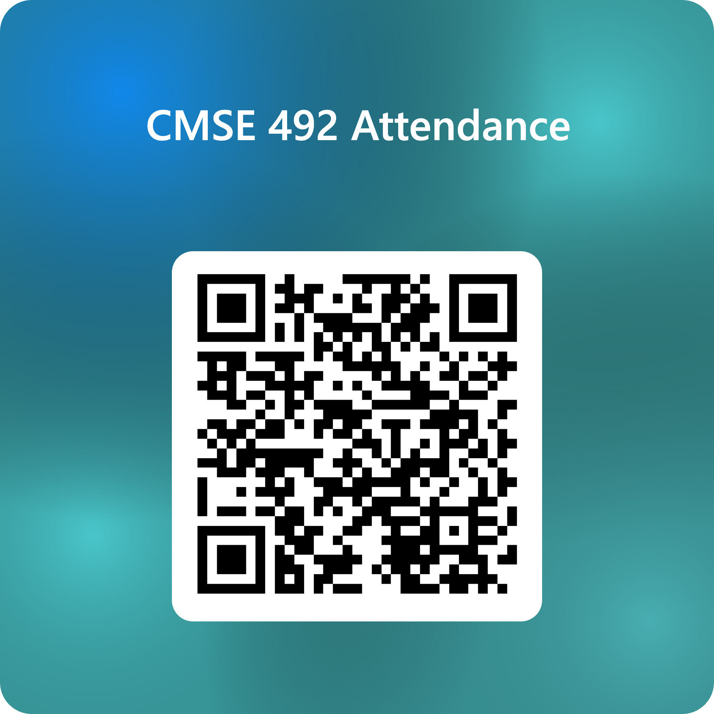

<!-- _class: title -->
# AI in the Real World
## Data, Power, & Society - Day 35

### Group 01 Presents

**CMSE 492 (aka CMSE 101) • Fall 2026**
Prof. Danny Caballero

  
## Today's Six Digits: 112326

---

# Today

1. **Group 01 presents**
2. **The Showcase:** expectations, again
3. **Deadlines** before and after the break
4. **Work time** with your Case Design team

---

<!-- _class: title -->
# Group 01 Presents

---

# Group 01 (Environmental Concerns)

## At 13:05

- Give them your full attention.
- **Ask questions.** It's the best part.
- **Group 01's exit ticket** is due on D2L today.

---

<!-- _class: break -->
# The Showcase: Expectations

---

# The Showcase Standard

| Meets the standard | Does not |
|---|---|
| **10–12 minutes** before questions | Under 10 minutes |
| Talking **to the audience**, short notes | Reading slides or a script aloud |
| **Everyone** presents a real part | One or two people carry it |
| **Rehearsed:** smooth handoffs, on time | Working out who's next as you go |
| Case, proposal, crux, **strongest objection** | Describes the topic, argues for nothing |
| Slides on D2L **before class** | Slides missing or late |

Miss the standard and the Showcase is **not meeting expectations**. Your Case Design **can't go above a 2.0**.

---

# What the Talk Must Include

- **Your case and your proposal**, clear enough that the audience could repeat them
- **The DTPA component(s)** your design turns on, and *why*
- **The AI literacies** your case depends on: *show* them, don't list them
- **What could go wrong**, and what you'd do about it

**12 minutes** presenting + **3 minutes** of questions. 8–12 slides is usually enough.

---

# Make It a Performance

Present **in a role**. It gives you someone to persuade, and it stops you from reading.

- **Pathway I:** startup pitch · product launch · procurement hearing
- **Pathway II:** legislative testimony · regulator's announcement · closing argument · advocacy campaign
- **Either:** bring in **the lobbyist** (your strongest objection, in character) or **the person affected**

*A role doesn't replace content: proposal, crux, evidence, objection.*

---

# How to Prepare

- **Rehearse out loud, together, with a timer, at least twice.**
- **Fewer words on slides.** If the sentence is on the slide, you'll read it.
- **Know your part cold.** Notes are cues, not a script.
- **Write down the three questions** you most expect, and decide who answers each.
- **Plan the handoffs.**

**Test:** if your slides vanished five minutes before class, could you still give the talk?

---

# Showcase Schedule

| Date | Showcase | Groups (in order) |
|:---:|---|---|
| **Mon, Dec 7** | Day 1 | **06** · **08** · **03** |
| **Wed, Dec 9** | Day 2 | **04** · **07** · **02** |
| **Fri, Dec 11** | Day 3 | **01** · **05** |

- **Order was randomized.**
- **Slides go on D2L before class** on your day.
- You can't submit your final essay until **after** your group presents.

---

# Deadlines

- **Today:** Exit Ticket (Group 01) on D2L
- **No class** Wed, Nov 25 or Fri, Nov 27. Enjoy the break!
- **Sun, Nov 29:** Week 14 Forum Post due
- **Mon, Nov 30:** Group 08 presents
- **Wed, Dec 2:** Group 06 presents
- **Fri, Dec 4:** Essay draft + response to Scaffold 2 feedback (>250 words) due
- **Dec 7 / 9 / 11:** Showcase (slides **before class**)
- **Tue, Dec 15, 11:59pm:** Final essay + "Changes after the Showcase" (team); cover letter (individual)

*The Final Case Design gets no second attempt.*

---

# Up Next: Group 08 (Athletics & Sport)

You present on **Monday, Nov 30**, right after the break. Please get to Danny:

- **Your session plan**
- **Your slides**
- **Your exit ticket** for the class

*Aim to send it before Thanksgiving.*

---

# Work Time

After the presentation, work with your Case Design team:

- **Thesis:** one sentence everyone can say
- **Crux:** the DTPA component(s) your design turns on, and *why*
- **Plan:** who writes which section by Dec 4, and when you'll rehearse
- **Showcase:** pick a role and sketch your talk

*You won't see each other in class again until Nov 30. We'll be circulating.*
